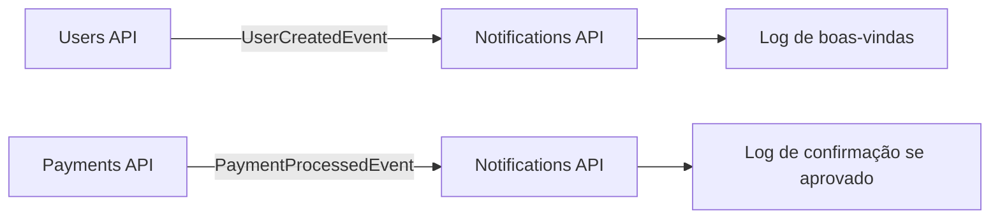

# FCG Notifications API

Microsserviço de notificações da plataforma **FIAP Cloud Games (FCG)**. Consome eventos publicados pelos demais serviços e registra no console o envio simulado de e-mails de boas-vindas e de confirmação de compra. O projeto não envia e-mails reais.

Este repositório é uma cópia de trabalho pessoal baseada no serviço desenvolvido pelo grupo e originalmente publicado por [Matheus Sampaio](https://github.com/sampaiobrenner/fcg-notifications-api). Os contratos de integração são mantidos em [`fcg-contracts`](https://github.com/sampaiobrenner/fcg-contracts); a infraestrutura local e os guias de implantação ficam em [`fcg-orchestration`](https://github.com/sampaiobrenner/fcg-orchestration).

## Responsabilidades

O serviço consome os eventos via RabbitMQ e MassTransit:

| Evento | Fila | Comportamento |
|---|---|---|
| `UserCreatedEvent` | `notifications.user-created` | Registra no console o e-mail de boas-vindas simulado. |
| `PaymentProcessedEvent` | `notifications.payment-processed` | Registra a confirmação da compra quando o pagamento é aprovado. Pagamentos rejeitados são registrados sem enviar confirmação. |



As filas e os eventos são definidos pelo pacote [`PosTech.Fiap.CloudGames.Contracts`](https://www.nuget.org/packages/PosTech.Fiap.CloudGames.Contracts), compartilhado pelos microsserviços.

## Tecnologias

- .NET 10 e ASP.NET Core Minimal API
- RabbitMQ e MassTransit 8
- PostgreSQL e Entity Framework Core 10
- Serilog, OpenAPI e Scalar
- Docker e Kubernetes
- xUnit para testes automatizados

## Pré-requisitos

- .NET SDK 10
- Docker com Docker Compose
- Acesso às dependências da plataforma: PostgreSQL e RabbitMQ

## Executar localmente

Para executar apenas este serviço, inicie PostgreSQL e RabbitMQ pelo repositório de orquestração:

```bash
git clone https://github.com/sampaiobrenner/fcg-orchestration.git
cd fcg-orchestration
docker compose up -d postgres rabbitmq
```

Em outro terminal, na raiz deste repositório, grave as configurações locais no armazenamento de User Secrets do .NET e inicie a API:

```bash
dotnet user-secrets set 'ConnectionStrings:Default' 'Host=localhost;Port=5432;Database=fcg_notifications;Username=fcg;Password=fcg' --project src/Fcg.Notifications.WebApi
dotnet user-secrets set 'RabbitMq:Host' 'localhost' --project src/Fcg.Notifications.WebApi
dotnet user-secrets set 'RabbitMq:Username' 'fcg' --project src/Fcg.Notifications.WebApi
dotnet user-secrets set 'RabbitMq:Password' 'fcg' --project src/Fcg.Notifications.WebApi
JWT_KEY="$(openssl rand -base64 48)"
dotnet user-secrets set 'Jwt:Key' "$JWT_KEY" --project src/Fcg.Notifications.WebApi
unset JWT_KEY

dotnet run --project src/Fcg.Notifications.WebApi
```

As credenciais de desenvolvimento ficam fora do repositório. O arquivo `appsettings.Development.json` não é versionado.

As migrations pendentes do banco são aplicadas na inicialização quando `Database__ApplyMigrationsOnStartup=true`, valor padrão do projeto.

| Endereço | Uso |
|---|---|
| <http://localhost:5104/scalar/v1> | Documentação OpenAPI/Scalar (Development e Testing) |
| <http://localhost:5104/health/live> | Verificação de processo ativo |
| <http://localhost:5104/health/ready> | Verificação de prontidão do banco de dados |

Os eventos consumidos são exibidos no log da aplicação. Para executar o fluxo completo com Users API, Catalog API e Payments API, consulte as instruções do [`fcg-orchestration`](https://github.com/sampaiobrenner/fcg-orchestration).

## Configuração

As configurações podem ser definidas em `appsettings.json` ou por variáveis de ambiente. No Kubernetes, valores não sensíveis ficam no ConfigMap e credenciais ficam no Secret.

| Variável | Obrigatória | Descrição | Exemplo local |
|---|---:|---|---|
| `ASPNETCORE_ENVIRONMENT` | Não | Ambiente de execução. | `Development` |
| `ASPNETCORE_HTTP_PORTS` | Não | Porta HTTP da aplicação no container. | `8080` |
| `ConnectionStrings__Default` | Sim | Conexão com o banco PostgreSQL. | `Host=localhost;Port=5432;Database=fcg_notifications;Username=fcg;Password=fcg` |
| `Database__ApplyMigrationsOnStartup` | Não | Aplica migrations ao iniciar. | `true` |
| `RabbitMq__Host` | Sim | Host do RabbitMQ. | `localhost` |
| `RabbitMq__VirtualHost` | Não | Virtual host do broker. | `/` |
| `RabbitMq__Username` | Sim | Usuário do RabbitMQ. | `fcg` |
| `RabbitMq__Password` | Sim | Senha do RabbitMQ. | `fcg` |
| `Messaging__Queues__NotificationsUserCreated` | Não | Fila de `UserCreatedEvent`. | `notifications.user-created` |
| `Messaging__Queues__NotificationsPaymentProcessed` | Não | Fila de `PaymentProcessedEvent`. | `notifications.payment-processed` |
| `Jwt__Issuer` | Não | Emissor aceito para tokens JWT. | `fcg-users-api` |
| `Jwt__Audience` | Não | Público aceito para tokens JWT. | `fcg` |
| `Jwt__Key` | Sim | Chave simétrica compartilhada pelos serviços; use pelo menos 32 caracteres. | Defina uma chave local segura. |

Os nomes padrão das filas vêm das constantes do pacote de contratos. Os valores de exemplo deste README e de `k8s/secret.yaml` são exclusivos para desenvolvimento local; não os reutilize em ambientes compartilhados ou de produção.

## Docker

O `Dockerfile` usa build em múltiplos estágios, imagem de runtime .NET 10 e usuário sem privilégios. Para construir a imagem:

```bash
docker build -t fcg-notifications-api:local .
```

O container escuta na porta `8080`. Para integrar a aplicação com PostgreSQL e RabbitMQ em containers, execute a stack pelo repositório de orquestração ou conecte os serviços à mesma rede Docker.

## Kubernetes

A pasta [`k8s/`](k8s/) contém os manifests deste microsserviço:

| Manifesto | Recurso |
|---|---|
| `deployment.yaml` | Deployment da API com probes e limites de recursos. |
| `service.yaml` | Service interno `notifications-api`, porta `80`. |
| `configmap.yaml` | Ambiente, host do broker, nomes de filas e configuração JWT não sensível. |
| `secret.yaml` | Credenciais locais de PostgreSQL, RabbitMQ e JWT. |

Com PostgreSQL e RabbitMQ já disponíveis no mesmo namespace, aplique os manifests:

```bash
kubectl apply -f k8s/
kubectl rollout status deployment/notifications-api
kubectl get pods -l app=notifications-api
```

O Deployment usa `ghcr.io/samueltorres-io/fcg-notifications-api:latest`. A imagem é publicada pelo workflow de CI após um push na branch padrão. Para instalar a plataforma completa e suas dependências, use os manifests do [`fcg-orchestration`](https://github.com/sampaiobrenner/fcg-orchestration).

## Testes

Execute os testes de unidade e integração com:

```bash
dotnet test
```

## CI/CD

O workflow [`ci.yml`](.github/workflows/ci.yml) restaura, compila e testa a solução em pull requests para `main`, pushes para `main` e `develop`, tags `v*` e execuções manuais. Em pull requests também constrói a imagem Docker. A imagem é publicada no GitHub Container Registry apenas em pushes para `main` e tags `v*`, com tags `latest` (branch padrão), `sha-<commit>` e semver.

A análise SonarCloud é opcional. Para habilitá-la, configure o secret `SONAR_TOKEN` e as variáveis de repositório `SONAR_PROJECT_KEY` e `SONAR_ORGANIZATION`.

## Estrutura do repositório

Cada projeto em `src/` possui um README com seu papel, os arquivos principais e os pontos em aberto:

- [Domain](src/Fcg.Notifications.Domain/README.md)
- [Application](src/Fcg.Notifications.Application/README.md)
- [Infrastructure](src/Fcg.Notifications.Infrastructure/README.md)
- [WebApi](src/Fcg.Notifications.WebApi/README.md)

```text
src/
  Fcg.Notifications.Domain/         Tipos e regras compartilhadas do domínio
  Fcg.Notifications.Application/    Abstrações de aplicação, segurança e validação
  Fcg.Notifications.Infrastructure/ Persistência, migrations e integração com o outbox
  Fcg.Notifications.WebApi/         Minimal API, configuração, health checks e consumers
test/
  Fcg.Notifications.UnitTests/
  Fcg.Notifications.IntegrationTests/
k8s/                                Manifests do microsserviço
```
